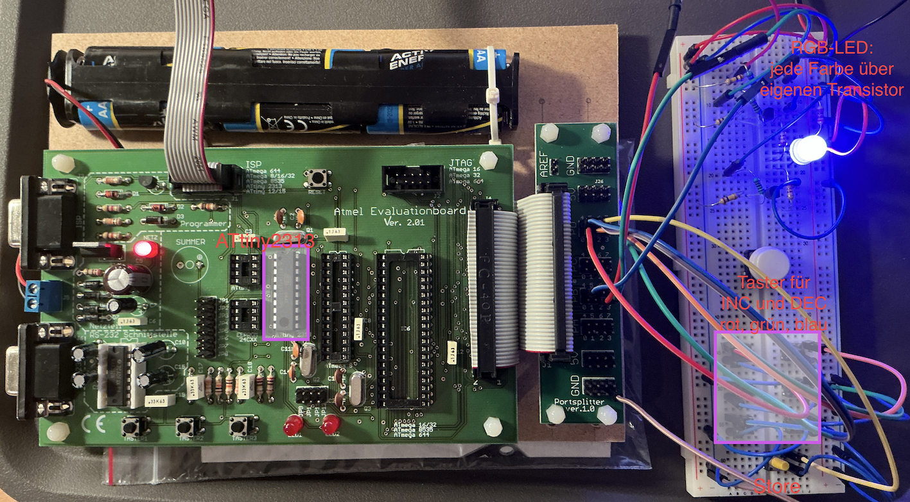

# AVR_Taschenlampe

Ein ATtiny2313 soll eine RGB-LED per PWM in ihrer Gesamtlichtfarbe beziehungsweise den Helligkeiten der einzelnen Farbkanäle steuern.

## Bedienanleitung

### Einschalten und Ausschalten

Den **ON-Taster drücken und gedrückt halten**. Die Taschenlampe leuchtet mit der zuletzt gespeicherten Farbe und Helligkeit. Bei der ersten Inbetriebnahme nach der Initialprogrammierung sind alle drei Farbkanäle auf den Wert 127 eingestellt.

Zum Ausschalten den ON-Taster loslassen. Nicht gespeicherte Änderungen gehen dabei verloren; beim nächsten Einschalten wird wieder die zuletzt gespeicherte Einstellung verwendet.

### Farbe und Helligkeit einstellen

Den ON-Taster während der gesamten Einstellung gedrückt halten. Die drei Farbkanäle lassen sich unabhängig voneinander verändern:

| Farbkanal | Heller | Dunkler |
|---|---|---|
| Rot | INC_rt | DEC_rt |
| Grün | INC_gn | DEC_gn |
| Blau | INC_bl | DEC_bl |

Ein kurzer Tastendruck erhöht beziehungsweise verringert den jeweiligen Helligkeitswert um 4. Zur Rückmeldung wird der geänderte Farbkanal kurz für etwa 15 ms ausgeschaltet; danach ist seine neue Helligkeit sichtbar. Wird die Taste länger gehalten, beginnt nach etwa einer halben Sekunde die automatische Wiederholung mit ungefähr zehn Änderungen pro Sekunde.

Würde der nächste Schritt über 255 oder unter 0 führen, wird genau der jeweilige Grenzwert erreicht: INC setzt beispielsweise 253 auf 255, DEC setzt 2 auf 0. Damit lässt sich jede Farbe vollständig ausschalten oder auf maximale Helligkeit stellen. Am Grenzwert bleibt der Kanal auch bei weiterem Halten oder erneutem Drücken derselben Taste stehen. Die entgegengesetzte Taste verändert ihn wieder um 4: von 0 auf 4 beziehungsweise von 255 auf 251.

Mehrere Farbkanäle können gleichzeitig eingestellt werden. Werden INC und DEC desselben Kanals gleichzeitig gedrückt, bleibt dieser Kanal unverändert.

Bei jeder tatsächlichen Wertänderung – auch bei automatischer Wiederholung – erhält nur der betroffene Farbkanal diesen kurzen Dunkelimpuls. Andere Farbkanäle bleiben sichtbar. Ist der Endwert bereits erreicht und ändert sich nichts, erfolgt kein weiterer Impuls. Tasterauswertung und Speicherung laufen unabhängig davon weiter; STORE hat Vorrang und behält seine Doppelblinkbestätigung.

### Einzelne Farben beim Einstellen anzeigen

Mit dem Jumper **JP1 (SOLO)** zwischen **PB0, Pin 12, und GND** lässt sich die Anzeige beim Einstellen umschalten:

| JP1 | Anzeige während INC/DEC |
|---|---|
| Offen | Die vollständige Farbmischung bleibt sichtbar. |
| Gesteckt | Nur die Farbkanäle mit gedrückten Einstelltasten sind sichtbar. |

Beispiel: Bei gestecktem JP1 blendet das Halten von INC_rt oder DEC_rt Grün und Blau aus. Rot bleibt sichtbar und wird eingestellt. Sobald die letzte Einstelltaste losgelassen und deren Freigabe entprellt wurde, erscheint wieder die vollständige Mischung mit dem neuen Rotwert. Die Werte der ausgeblendeten Kanäle bleiben erhalten.

Werden mehrere Farbkanäle gleichzeitig eingestellt, sind diese gemeinsam sichtbar. Bei gleichzeitigem INC und DEC eines Kanals bleibt dieser sichtbar, aber sein Wert unverändert. Das Ausblenden funktioniert auch dann, wenn der bearbeitete Kanal bereits seinen Grenzwert erreicht hat. Tasten, die beim Einschalten gehalten und noch nicht freigegeben wurden, lösen keine Einzelanzeige aus.

Der Jumper wird laufend ausgewertet und kann während des Betriebs geändert werden. STORE speichert unabhängig vom Modus immer die tatsächlichen Werte aller drei Farbkanäle. Die Doppelblinkbestätigung verwendet weiterhin alle drei Farben.

### Einstellung speichern

1. Die gewünschte Farbe und Helligkeit einstellen und die Einstelltasten loslassen. ON weiterhin gedrückt halten.
2. **STORE einmal drücken**.
3. Die Bestätigung abwarten: Die LED blinkt zweimal mit der vorgesehenen Weißmischung und zeigt danach wieder die eingestellte Farbe. ON bis zum Ende dieser Bestätigung gedrückt halten.
4. Anschließend kann ON losgelassen werden. Die Einstellung wird beim nächsten Einschalten wiederhergestellt.

Wenn die aktuelle Einstellung bereits gespeichert ist, bewirkt STORE keine erneute Speicherung und die LED blinkt nicht. Längeres Gedrückthalten von STORE löst keine zusätzlichen Speichervorgänge aus.

Während des Speicherns und Blinkens werden die Bedientasten ignoriert. Für weitere Änderungen gegebenenfalls noch gehaltene Einstelltasten oder STORE zuerst loslassen und erneut drücken. Das gilt auch für Tasten, die bereits beim Einschalten gehalten wurden.

### Test auf dem Evaluationboard

Diese Bedienanleitung beschreibt die eigenständig versorgte Taschenlampe. Beim Test mit dem ATtiny auf dem Evaluationboard schaltet der ON-Taster am Steckbrett nur die LED-Versorgung. Der Mikrocontroller läuft weiter; das Einschalten mit erneutem Laden der gespeicherten Werte wird dort durch einen Reset am Evaluationboard getestet. Anschluss- und Programmierhinweise stehen in der [Firmware-Anleitung](firmware/README.md).

## Funktion

### Stromversorgung

Die Schaltung wird mit drei AAA-Batterien zu je 1,5 V betrieben. Die Nennspannung beträgt somit 4,5 V.

### ON Taster

Der ON-Taster schließt den positiven 4,5-V-Zweig und versorgt die gesamte Schaltung einschließlich des ATtiny2313 mit Spannung. Die Taschenlampe leuchtet nur, solange der ON-Taster gehalten wird.

Beim Einschalten werden die Helligkeitswerte für Rot, Grün und Blau aus dem internen EEPROM gelesen und gemäß den unter „internes EEPROM“ beschriebenen Regeln geprüft. Die Einzel-LEDs erhalten die entsprechenden PWM-Signale. Lichtblitze beim Einschalten sollen vermieden werden.

Nach dem Einschalten wird ausschließlich die gespeicherte beziehungsweise bei einem Speicherfehler die vorgesehene Ersatzhelligkeit des jeweiligen Farbkanals ausgegeben; vorher bleiben alle Farbkanäle aus.

Beim Einschalten bereits gedrückte INC-, DEC- und STORE-Taster werden erst nach dem Loslassen und einem erneuten Drücken ausgewertet.

Beim Loslassen des ON-Tasters erlischt die LED. Änderungen, die nicht mit STORE gespeichert wurden, gehen verloren.

### Common-Anode LED

Die Common-Anode-LED besteht aus drei Einzel-LEDs mit gemeinsamer Anode: jeweils einer für Rot, Grün und Blau.

Der Helligkeitswert jedes Farbkanals liegt zwischen 0 (vollständig aus) und 255 (vollständig an).

Die PWM-Frequenz ist bei der Firmware-Konfiguration einstellbar. Ein durch eine zu niedrige PWM-Frequenz verursachtes Flimmern ist bei Bedarf durch Anpassen dieser Konfiguration zu beheben. Mit „Anwender“ ist hierbei die Person gemeint, die die Firmware konfiguriert und programmiert.

### Taster für Helligkeitswerte der Einzel-LEDs

Für jeden Farbkanal gibt es einen Taster zum Erhöhen (INC) und einen zum Verringern (DEC) der Helligkeit:

- INC_rt, DEC_rt
- INC_gn, DEC_gn
- INC_bl, DEC_bl

Alle Taster außer dem ON-Taster sind zu entprellen. Dies gilt auch für STORE.

Ein entprellter Tastendruck verändert den Helligkeitswert des jeweiligen Kanals sofort um +4 (INC) beziehungsweise −4 (DEC) Einheiten. Zur optischen Schrittrückmeldung wird die PWM-Ausgabe nur dieses Kanals für etwa 15 ms auf 0 gesetzt und anschließend der neue Wert ausgegeben. Die Rückmeldung blockiert die Tasterauswertung nicht und wird nur bei einer tatsächlichen Wertänderung ausgelöst.

Die Helligkeit wird in Schritten von ±4 verändert und auf den Wertebereich 0 bis 255 begrenzt. Würde INC über 255 hinausführen, wird auf 255 gesetzt; würde DEC unter 0 führen, wird auf 0 gesetzt. Der letzte Schritt darf dadurch kleiner als 4 sein. Beispiele: INC verändert 253 auf 255, DEC verändert 2 auf 0. Auch ausgehend vom Startwert 127 werden beide Endwerte erreicht. Weiteres Halten oder erneutes Drücken derselben Taste lässt den Grenzwert unverändert. Die Gegenrichtung arbeitet von dort mit einem vollen Schritt weiter: INC von 0 auf 4, DEC von 255 auf 251. Es erfolgt kein Umlauf.

Nach 500 ms Gedrückthalten wird die Änderung alle 100 ms wiederholt, bis die Taste losgelassen wird.

Verschiedene Farbkanäle lassen sich gleichzeitig einstellen. Sind INC und DEC desselben Kanals gleichzeitig gedrückt, bleibt dieser Kanal unverändert; andere Kanäle werden weiterhin ausgewertet.

### Jumper für die Einzelkanalanzeige

JP1 verbindet PB0 (DIP-Pin 12) mit GND. Der Eingang nutzt den internen Pull-up; offen entspricht HIGH und der bisherigen Mischanzeige, gesteckt entspricht LOW und der Einzelkanalanzeige während INC/DEC. PB1 bleibt frei.

Die Firmware wertet JP1 in jedem Bedienzyklus aus. Bei gestecktem JP1 werden nur Kanäle mit entprellten, freigegebenen und gehaltenen INC-/DEC-Tasten ausgegeben; alle übrigen PWM-Ausgänge werden vorübergehend auf 0 gesetzt. Ohne aktive Einstelltaste wird die volle Mischung ausgegeben. Die zugrunde liegenden RGB-Werte werden durch diese Anzeigeauswahl nicht verändert. Speichern und Blinkbestätigung behalten Vorrang; danach gelten weiterhin die Regeln zur erneuten Tastenfreigabe.

### Store Taster

Der STORE-Taster dient zum dauerhaften Speichern der aktuellen Helligkeitswerte für Rot, Grün und Blau im internen EEPROM. Erst nach dem Speichern stehen geänderte Werte beim nächsten Einschalten wieder zur Verfügung.

Beim Drücken von STORE werden die aktuellen Werte aller drei Kanäle als gemeinsamer Stand übernommen. Falls gleichzeitig eine Helligkeitsänderung erkannt wird, wird zuerst diese Änderung ausgeführt und anschließend gespeichert.

Die Speicherung wird nur ausgelöst, wenn sich aktuelle Werte von den gespeicherten Werten unterscheiden. Stimmen alle Werte überein, wird weder geschrieben noch eine Blinkbestätigung ausgegeben. Für ungültige EEPROM-Einträge gilt die unter „internes EEPROM“ beschriebene Ausnahme.

Pro Tastendruck wird höchstens einmal gespeichert und einmal durch doppeltes Blinken bestätigt, auch wenn STORE länger gedrückt bleibt.

Während des Speicherns und der Blinkbestätigung werden INC, DEC und STORE ignoriert. Danach werden noch gehaltene Tasten erst nach dem Loslassen und erneutem Drücken ausgewertet.

Nach erfolgreichem Speichern blinkt die LED zweimal weiß mit RGB (127, 127, 127): jeweils 200 ms an und 200 ms aus. Die Bestätigung funktioniert dadurch auch bei zuvor ausgeschalteten Farbkanälen. Danach werden die aktuellen Helligkeitswerte wieder angezeigt.

Der ON-Taster muss bis zum Ende der Bestätigung gehalten werden. Anschließend kann er losgelassen werden; die neuen Werte sind gespeichert und werden beim nächsten Einschalten verwendet.

### internes EEPROM

Bei der Programmierung des ATtiny2313 werden die initialen Helligkeitswerte im internen EEPROM auf RGB (127, 127, 127) festgelegt.

Beim Einschalten werden die gespeicherten Werte pro Kanal auf Gültigkeit geprüft. Ein fehlender oder als ungültig erkennbarer Kanalwert wird nur für diesen Kanal durch den Standardwert 127 ersetzt. Sind alle drei Werte ungültig, ergibt sich RGB (127, 127, 127).

Nach einem unterbrochenen Speichervorgang wird mit den vorliegenden gültigen EEPROM-Werten gearbeitet. Dabei dürfen gültige alte und neue Kanalwerte gemeinsam verwendet werden. Ein unvollständig geschriebener oder beschädigter Kanalwert muss als ungültig erkennbar sein und wird durch 127 ersetzt. Der Zahlenwert 255 allein gilt nicht als Fehler, da er zum erlaubten Wertebereich gehört.

Ersatzwerte werden zunächst nur für den laufenden Betrieb verwendet. Erst ein erneuter STORE-Tastendruck speichert sie dauerhaft. Dabei gilt ein ungültiger EEPROM-Eintrag als Abweichung, auch wenn der Ersatzwert bereits 127 beträgt.

## Umsetzung

### Schaltplan

[KiCad-Schaltplan](hardware/AVR_Taschenlampe.kicad_sch) auf DIN A4 im Querformat, [KiCad-Projekt](hardware/AVR_Taschenlampe.kicad_pro) und [Vorschau](hardware/preview/AVR_Taschenlampe.svg).

Details zu Pinbelegung, Bauteilen, LED-Auswahl und Prüfung stehen in der [Schaltungsdokumentation](hardware/README.md).

### Platinenlayout

[Belegungsplan für 24 × 18 Löcher im Hochformat](hardware/lochraster-24x18-hochformat.md) mit Lochkoordinaten und Drahtliste. Die [Zeichnung](hardware/lochraster-24x18-hochformat.svg) zeigt die Bestückungsseite, die gespiegelte Lötseite und den Drahtverlauf von oben. Zum Umplatzieren und Entflechten gibt es ein [editierbares KiCad-Board](hardware/lochraster-24x18-hochformat.kicad_pcb).

### Codierung

[Firmware und Anleitung zum Bauen und Programmieren](firmware/README.md), [Programmcode](firmware/src/main.c).

Die erste Version für den ATtiny2313 enthält RGB-PWM, Tasterbedienung und EEPROM-Speicherung. Flash- und EEPROM-Dateien werden getrennt erzeugt; Am 16.11.2026 hat der Anwender auf dem Evaluationboard die Helligkeitsänderung je Farbkanal über INC/DEC, das Speichern mit STORE einschließlich Doppelblinken sowie die Wiederherstellung der zuletzt gespeicherten Farbe nach RESET erfolgreich geprüft.

## Programmierung und Testaufbau 

- mit Pollin Evaluationboard und Portsplitter
  - ATtiny2313
  - RGB-LED, jede Farbe wird über eigenen Transistor angesteuert
  - 6 Taster für INC & DEC der Helligkeit jeder Farbe rot, grün, blau
  - Store-Taster, zum Speicher der Helligkeitswerte in ATtiny internen EEPROM

## weitere Dokumentation

siehe im Verzeichnis [docs](docs/docs.md)
